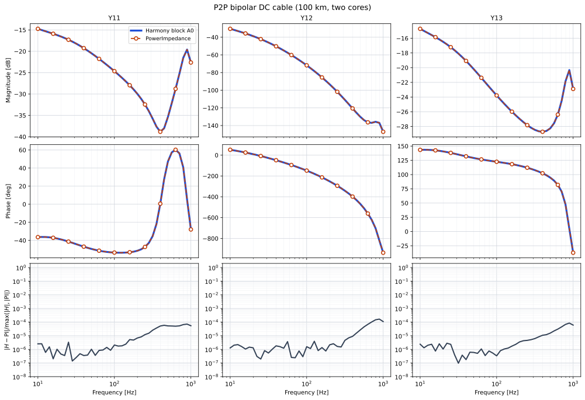

# Point-to-point HVDC

Julia project tag `v0.4.0`. Overlays are Harmony blue solid, the reference orange dashed. Checked-in artefacts are SVG only.

## Redo

From the repository root, `harmony` conda env, Gurobi on `PATH`, Julia 1.10+. On Windows set `PYTHONIOENCODING=utf-8`.

```bash
julia --project=benchmarking/powerimpedance -e "using Pkg; Pkg.instantiate()"
python benchmarking/powerimpedance/run_all.py
```

`run_all.py` rebuilds the JSON, runs the reference sweep, runs Harmony, and writes the overlays. The operating point is `p2p/harmony/p2p_pi_op.json`.

Relative error is \(\|Y_H-Y_{PI}\|/\|Y_{PI}\|\). The converter rows negate both AC current rows (load sign on the reference). The q axis is not reflected.

## Reference frame

The network kernel and the MMC use the PSCAD frame: \(v_d=V\cos\theta\), \(v_q=-V\sin\theta\), and a passive inductor has \(Z_{dq}=+\omega L\), \(Z_{qd}=-\omega L\). That is the PSCAD abc/dq block with `qaxis=1` (q from \(+\sin\)).

## P2P HVDC

`g4 — tl1 (25 km) — c1 — DC cable (100 km) — c2 — tl78 (90 km) — g1`. Cut at c2 AC (B6). \(S=1000\,\mathrm{MW}\), \(V_{ac,LL}=380\,\mathrm{kV}\), \(V_{dc}=800\,\mathrm{kV}\). Scheduled \(Q=-100\,\mathrm{Mvar}\) is power delivered to the AC bus, the same point as \(q_{ref}=-0.1\,\mathrm{pu}\).

| Quantity | Samples | Mean | Max |
|----------|---------|------|-----|
| DC cable \(Y\) | 41 | \(1.16\times 10^{-5}\) | \(7.74\times 10^{-5}\) |
| \(Z_{eq}\) at B6 | 41 | \(4.38\times 10^{-3}\) | \(5.45\times 10^{-3}\) |
| \(Y_n\) at B6 | 41 | \(6.83\times 10^{-5}\) | \(1.53\times 10^{-4}\) |
| \(Z_{in}\) at B6 | 41 | \(7.28\times 10^{-2}\) | \(0.455\) |
| \(H\) at B6 | 41 | \(4.35\times 10^{-3}\) | \(5.45\times 10^{-3}\) |



