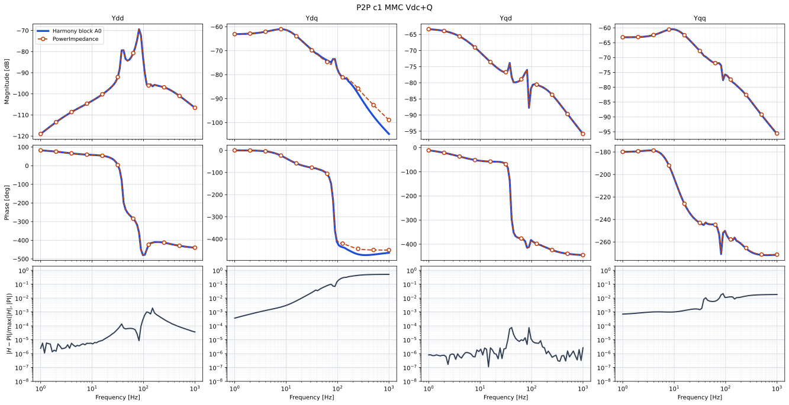
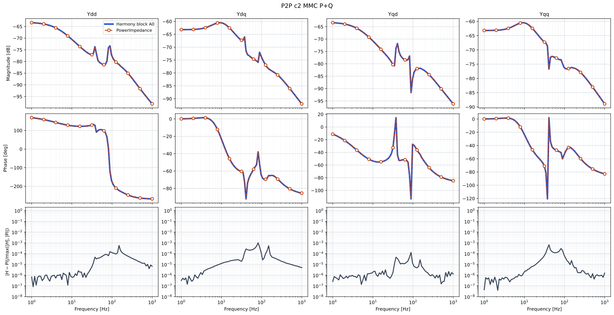
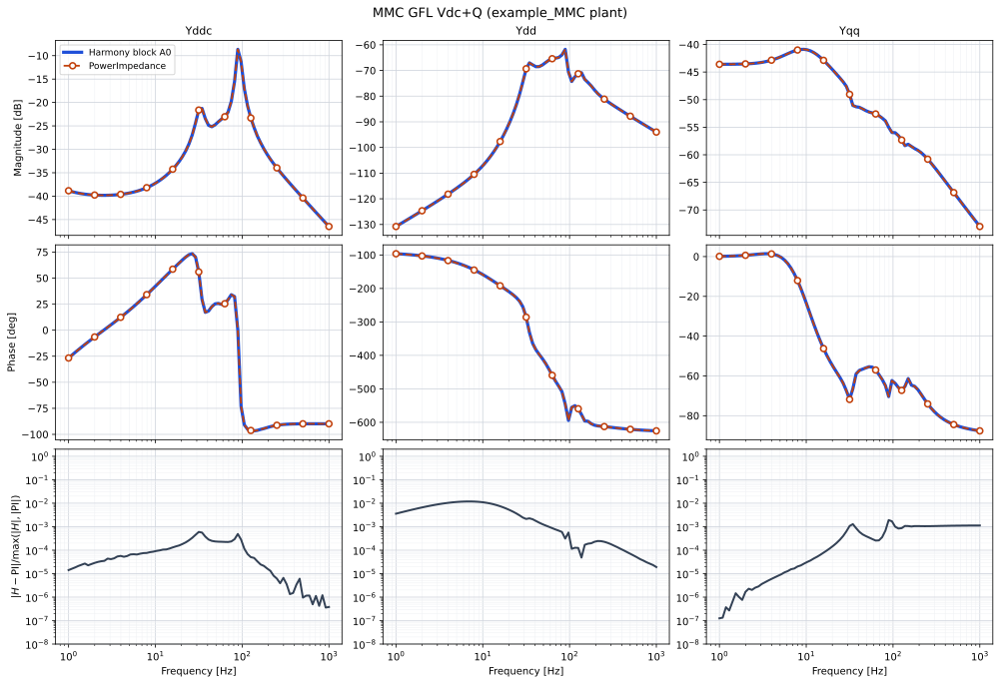
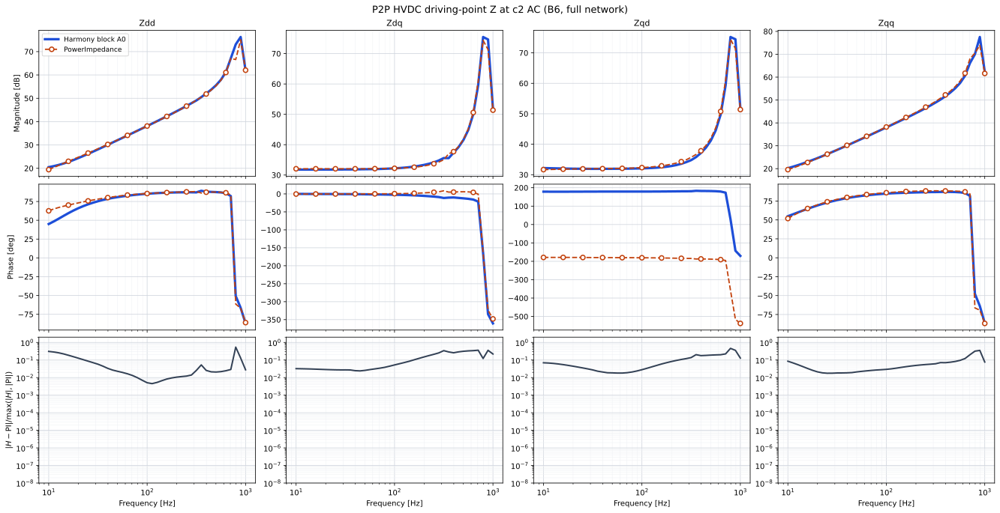
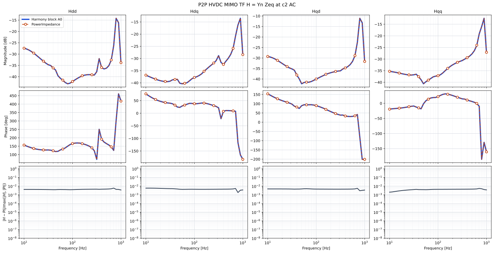
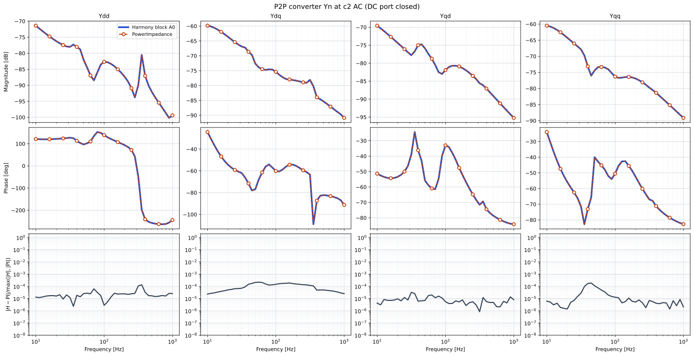
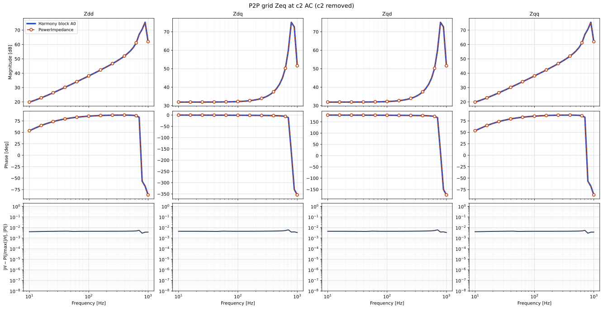

# Harmony vs PowerImpedance.jl

Results, Park, and the models Harmony cannot run: [harmony_pscad.md](harmony_pscad.md). Equations: [missing_models.pdf](missing_models.pdf).

Julia project and the sweep scripts are tag `v0.4.0`. Overlays are Harmony blue solid, PowerImpedance orange dashed. Checked-in artefacts are SVG only.

## Redo

From the repository root, `harmony` conda env, Gurobi on `PATH`, Julia 1.10+. On Windows set `PYTHONIOENCODING=utf-8`.

```bash
julia --project=benchmarking/powerimpedance -e "using Pkg; Pkg.instantiate()"
python benchmarking/powerimpedance/run_all.py
```

```bash
python benchmarking/powerimpedance/run_all.py --case standalone
python benchmarking/powerimpedance/run_all.py --case lines
python benchmarking/powerimpedance/run_all.py --case p2p
python benchmarking/powerimpedance/run_all.py --skip-julia
```

`run_all.py` rebuilds JSON, sweeps PowerImpedance, runs Harmony, writes overlays, and deletes intermediate CSVs. It prints a per-case timing breakdown.

P2P overlays use `p2p/harmony/p2p_pi_op.json`. The gtest `P2PBlockParkVsPerComponent` loads `p2p/harmony/p2p.json`.

| Path | Contents |
|------|----------|
| `standalone/` | resistor, transformer, cable, OHL, MMC |
| `lines/` | named OHL and cable layouts. Geometry: `lines/geometry.md` |
| `p2p/` | point-to-point HVDC |
| `examples/` | `NetworkBuilder` examples. `python examples/run_examples.py` |
| `twolevel/` | 2LC device sweeps. `julia twolevel/run_pi_2lc.jl`, then `python twolevel/run_2lc.py` |
| `controls/` | PowerImpedance against its PSCAD files |

Relative error is \(\|Y_H-Y_{PI}\|/\|Y_{PI}\|\). Converter comparisons negate both AC current rows. That is PowerImpedance's load sign. The q axis is not reflected.

## Reference frame

The network kernel, the MMC, and the two-level model use the PowerImpedance frame: \(v_d=V\cos\theta\), \(v_q=-V\sin\theta\), and a passive inductor has \(Z_{dq}=+\omega L\), \(Z_{qd}=-\omega L\). That is the PSCAD abc/dq block with `qaxis=1` (q from \(+\sin\)). The MATLAB PV, type-3, and type-4 models stay on their own frame.

## Standalone

| Case | Samples | Mean | Max |
|------|---------|------|-----|
| resistor | 11 | \(0\) | \(0\) |
| Y-Y transformer | 41 | \(1.11\times 10^{-6}\) | \(3.17\times 10^{-6}\) |
| aerial cable \(Y\) | 41 | \(8.54\times 10^{-6}\) | \(7.51\times 10^{-5}\) |
| OHL \(Y\) | 41 | \(1.33\times 10^{-5}\) | \(1.37\times 10^{-4}\) |
| GFL MMC \(Y\), \(P+Q\) | 81 | \(5.30\times 10^{-4}\) | \(1.58\times 10^{-3}\) |
| GFL MMC \(Y\), \(V_{dc}+Q\) | 81 | \(4.90\times 10^{-4}\) | \(1.39\times 10^{-3}\) |
| c1 \(Y_{ac}\), \(V_{dc}+Q\) | 81 | \(1.11\times 10^{-5}\) | \(5.61\times 10^{-5}\) |
| c2 \(Y_{ac}\), \(P+Q\) | 81 | \(1.59\times 10^{-5}\) | \(5.94\times 10^{-5}\) |







## PSCAD references

PowerImpedance against its own PSCAD files. Harmony has no matching component.

| Case | Samples | Mean | Max |
|------|---------|------|-----|
| GFM MMC, total energy | 58 | \(5.69\times 10^{-4}\) | \(4.28\times 10^{-3}\) |
| GFM MMC, leg energy, AC block | 23 | \(5.31\times 10^{-4}\) | \(1.16\times 10^{-3}\) |
| Two-level, \(V_{dc}\) + QV-droop | 28 | \(1.51\times 10^{-3}\) | \(2.50\times 10^{-3}\) |
| Two-level, \(P+Q\) | 36 | \(1.60\times 10^{-3}\) | \(3.02\times 10^{-3}\) |
| Synchronous machine | 240 | \(3.39\times 10^{-3}\) | \(0.203\) |
| Induction machine | 80 | \(9.44\times 10^{-4}\) | \(4.88\times 10^{-3}\) |

## Lines

21 points, 10 Hz–1 kHz. Geometry: [`lines/geometry.md`](lines/geometry.md).

| Case | Mean | Max |
|------|------|-----|
| `ohl_flat2` twin bundle | \(2.02\times 10^{-6}\) | \(9.22\times 10^{-6}\) |
| `ohl_flat3` | \(1.90\times 10^{-6}\) | \(8.77\times 10^{-6}\) |
| `ohl_flat3_nogw` | \(1.85\times 10^{-6}\) | \(8.95\times 10^{-6}\) |
| `ohl_flat6` | \(1.31\times 10^{-2}\) | \(1.55\times 10^{-2}\) |
| `ohl_vert3` | \(1.79\times 10^{-6}\) | \(8.51\times 10^{-6}\) |
| `ohl_vert6` | \(8.16\times 10^{-3}\) | \(1.11\times 10^{-2}\) |
| `ohl_delta3` | \(1.76\times 10^{-6}\) | \(8.62\times 10^{-6}\) |
| `ohl_delta6` | \(7.47\times 10^{-3}\) | \(1.03\times 10^{-2}\) |
| `ohl_conc3` / `ohl_off3` | \(1.89\times 10^{-6}\) | \(7.79\times 10^{-6}\) |
| `ohl_conc6` | \(1.12\times 10^{-3}\) | \(1.74\times 10^{-3}\) |
| `ohl_vert3_twin` | \(1.95\times 10^{-6}\) | \(7.49\times 10^{-6}\) |
| aerial / UG cables | \(1.18\times 10^{-5}\) | \(6.56\times 10^{-5}\) |

## P2P HVDC

`g4 — tl1 (25 km) — c1 — DC cable (100 km) — c2 — tl78 (90 km) — g1`. Cut at c2 AC (B6). \(S=1000\,\mathrm{MW}\), \(V_{ac,LL}=380\,\mathrm{kV}\), \(V_{dc}=800\,\mathrm{kV}\). Scheduled \(Q=-100\,\mathrm{Mvar}\) is power delivered to the AC bus, the same point as PowerImpedance \(q_{ref}=-0.1\,\mathrm{pu}\).

| Quantity | Samples | Mean | Max |
|----------|---------|------|-----|
| DC cable \(Y\) | 41 | \(1.16\times 10^{-5}\) | \(7.74\times 10^{-5}\) |
| \(Z_{eq}\) at B6 | 41 | \(4.38\times 10^{-3}\) | \(5.45\times 10^{-3}\) |
| \(Y_n\) at B6 | 41 | \(6.83\times 10^{-5}\) | \(1.53\times 10^{-4}\) |
| \(Z_{in}\) at B6 | 41 | \(7.28\times 10^{-2}\) | \(0.455\) |
| \(H\) at B6 | 41 | \(4.35\times 10^{-3}\) | \(5.45\times 10^{-3}\) |








