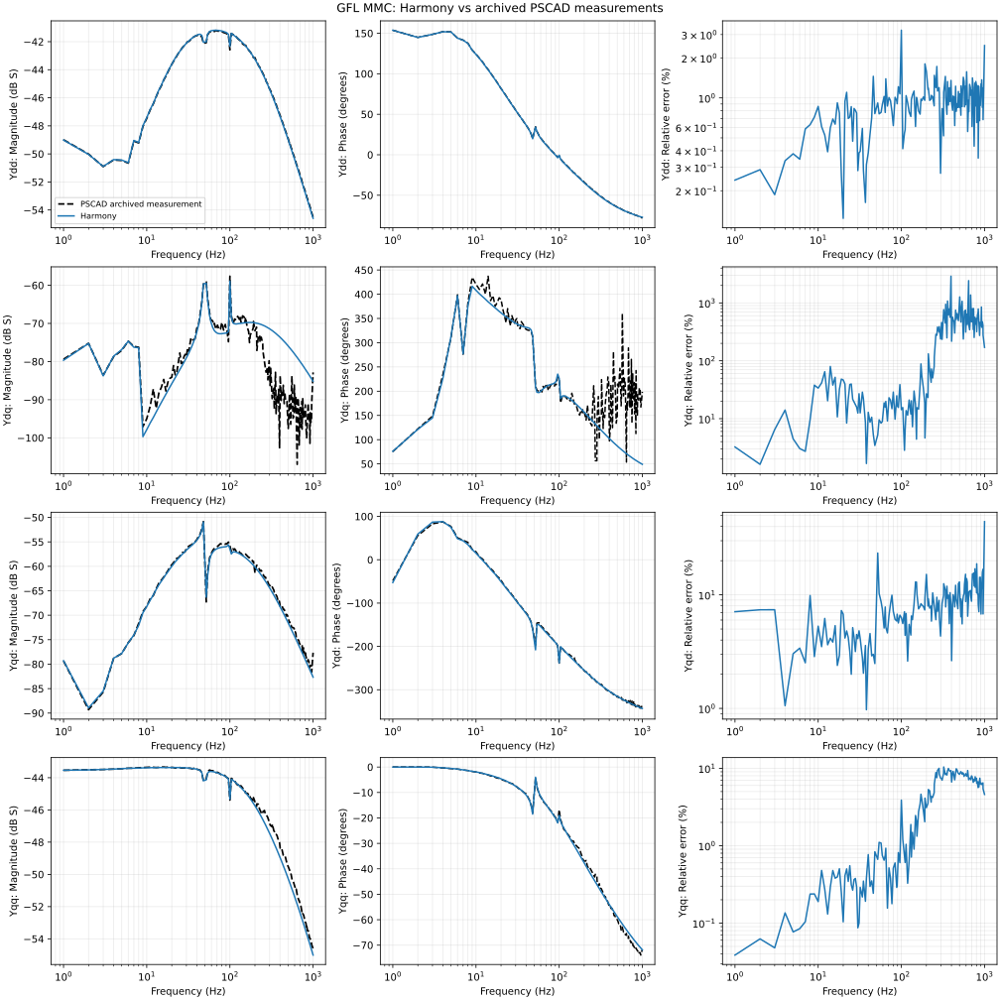

# GFL MMC: Harmony reference versus PSCAD

This self-contained benchmark verifies the corrected Python averaged GFL MMC reference against an archived PSCAD terminal-admittance dataset. It does not assert validation of the Harmony C++ MMC implementation.

## Results

All 160 measured frequency samples from 1 to 1000 Hz are retained. The arithmetic mean of the relative complex 2x2 matrix Frobenius error is **3.605989%**, and the maximum is **7.982933% at 323 Hz**. The working acceptance criterion is a mean below 5%; it is not a bound on each frequency or entry and is not a stability certificate.

| Frequency band | Mean matrix error |
|---|---:|
| 1 <= f < 10 Hz | 0.262801% |
| 10 <= f < 50 Hz | 0.781658% |
| 50 <= f < 100 Hz | 1.404165% |
| 100 <= f < 500 Hz | 4.537955% |
| 500 <= f <= 1000 Hz | 5.999299% |



## Reproduce without PSCAD

Use Python 3.13 or a compatible Python with the listed scientific packages:

```sh
python -m pip install -r requirements.txt
python -m unittest discover -s harmony -p "test_model.py" -v
python run.py
```

`run.py` integrates 40 perturbation cases and a companion baseline over two seconds, with a 20 microsecond integration step and controller/modulation hold. It reconstructs the voltage excitation from `data/voltage_excitation.npz`, independently predicts the currents, subtracts the baseline and extracts the complex admittance. The excitation file contains voltage coefficients and frequency groups, not fitted current responses. Currents from PSCAD are used only for validation. Runtime depends on the machine; allow several minutes.

The result uses finite-amplitude time-domain verification, including controller limits and integrator-freeze logic. It should be interpreted under the documented excitation conditions. `results/benchmark_metrics.json`, `harmony_admittance.csv`, `benchmark_response.npz` and the PNG/SVG overlay are regenerated. The CSV stores load-convention AC admittances directly, in the order Ydd, Ydq, Yqd, Yqq; do not negate them again.

## Model and conventions

- Base: 100 MVA, 240 kV DC, 122.4745 kV line-to-line RMS AC, 50 Hz; stiff DC boundary.
- Half-bridge MMC with 50 cells per arm; 10 mF per cell, equivalent arm capacitance 200 microfarads.
- Configured switch resistance: 1.07 ohm per cell, giving 53.5 ohm per conducting arm. Equivalent AC resistance is 27.285 ohm and inductance 85 mH. These reproduce this particular PSCAD configuration; they are not generic MMC design recommendations.
- Positive AC power and validation current enter the converter. The model's internal generator-current convention is converted by the runner.
- Initial equilibrium: Pac 99.8456 MW, Qac -0.320945 MVAr. Simulation power references: 100 MW and 0 MVAr.
- The 24-state averaged model retains selected arm harmonics, PLL, outer P/Q loops, current controllers, circulating-current suppression and controller limits. Individual cell sorting and switched PWM are not represented.
- `harmony/mmc_parameters.json` documents nominal ratings and control settings; the constructor and `run.py` define the executable case.

The corrections include per-cell resistance scaling, circulating-current coordinate transformations, current-loop decoupling, controller limits and checked equilibrium initialization. Nine regression tests check the principal physical and numerical invariants. High-frequency disagreement remains under investigation.

## PSCAD measurement source project

`pscad/MMC_GFL_Benchmark.pscx` is the archived switched GFL project associated with the PSCAD measurement dataset used in this result. Its project file is copied unchanged from the development benchmark. `pscad/MMC_GFL_Benchmark.pswx` has only its external toolbox path made portable.

The archived measurements were produced using Z-tool. Obtain the original toolbox from https://gitlab.kuleuven.be/electa/Z-Tool/Z-tool and place its contents under `external/Z-tool/` relative to this benchmark directory. The workspace expects `external/Z-tool/Source/ztoolacdc/Scan/Z_tool.pslx`. Open `pscad/MMC_GFL_Benchmark.pswx` in a licensed PSCAD installation. The scan frequency tables and topology are included; third-party toolboxes and generated EMT build files are excluded.

The native IMTB variant is deliberately excluded from this selected-result package because it did not generate these measurements. This does not change the converter verification result.

## The selected four-panel figure

`results/admittance_magnitudes.png` is the black-and-white four-panel PSCAD/Harmony comparison selected for the report. Run `python plot_selected_result.py` to regenerate it and a vector SVG from the packaged complex responses. The larger `results/overlay_Y.png` and SVG add phase and entry-wise errors using exactly the same data.

The upload runner has already reproduced the archived result exactly: 3.605989267649852% mean matrix error and 7.982932779744112% maximum at 323 Hz. All four complex admittance arrays are identical to the archived result, not merely visually similar. The nine model regression tests pass.

## Scope of this upload

Only this benchmark directory is intended for upload. Reports, IPST drafts, TenneT network models, unrelated source changes, third-party toolbox downloads and generated PSCAD build products are excluded. This package does not modify `src/Elements/Converter/MMC.cpp` or `MMC.h`.
