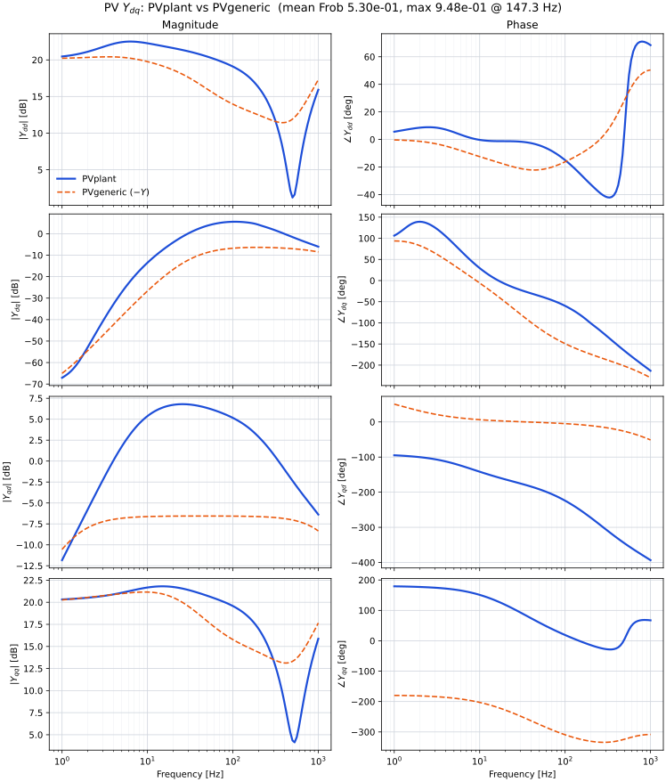

# PVplant vs PVgeneric Ydq

Same 1 MW, 315 V, 50 Hz pack as `example_PV_plant`. `PVplant` is the symbolic admittance (ideal-diode slope, boost PI on PV voltage, no Q loop). `PVgeneric` is the ODE model (same ideal diode, PSCAD power-mode boost, Q loop, voltage feedforward off). Current, DC-voltage and PLL gains are copied. The boost gain is the voltage-loop gain divided by 60 W/V so the duty command is the same order.

$$
k_{ff} = 0
$$

`PVgeneric` settles on the high-voltage side of the requested power. `PVplant` linearises at the ideal-diode maximum-power point

$$
v_{pv} = 506.34\,\mathrm{V}, \quad i_{pv} = 1994\,\mathrm{A}, \quad \frac{dP}{dV} = 0.
$$

```bash
python benchmarking/pv_ode/run.py
```

PVplant is blue, PVgeneric is orange dashed. The ODE port current leaves the plant. On this pack the injection sign matches after a minus, so the figure plots the negative of the `PVgeneric` admittance.



## Result (this machine)

120 log-spaced points, 1 Hz to 1000 Hz. `PVgeneric` equilibrium:

$$
v_{pv} = 508.05\,\mathrm{V}, \quad i_{pv} = 1987\,\mathrm{A}, \quad g_{pv} = 4.07\,\mathrm{S}.
$$

Wall time about 9 s. The error in the table is

$$
\frac{\lVert Y_{\mathrm{old}} - Y_{\mathrm{ode}} \rVert_F}{\lVert Y_{\mathrm{old}} \rVert_F}.
$$

| Metric | Value |
|--------|--------|
| Mean, 1 Hz to 1000 Hz | 0.53 |
| Maximum | 0.95 at 147 Hz |
| Mean, 1 Hz to 10 Hz | 0.21 |

At 1 Hz the diagonal entries are within about 10%:

$$
Y_{dd}, \quad Y_{qq}.
$$

Above that the curves separate: `PVplant` has no Q loop and no current-loop decoupling, and its boost PI regulates PV voltage.
